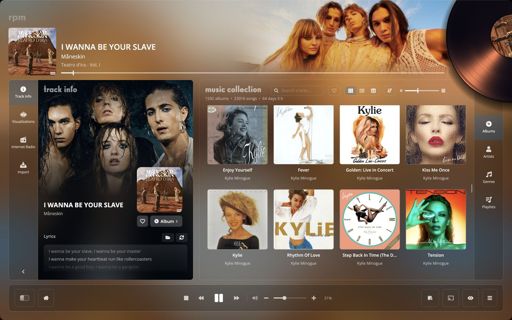
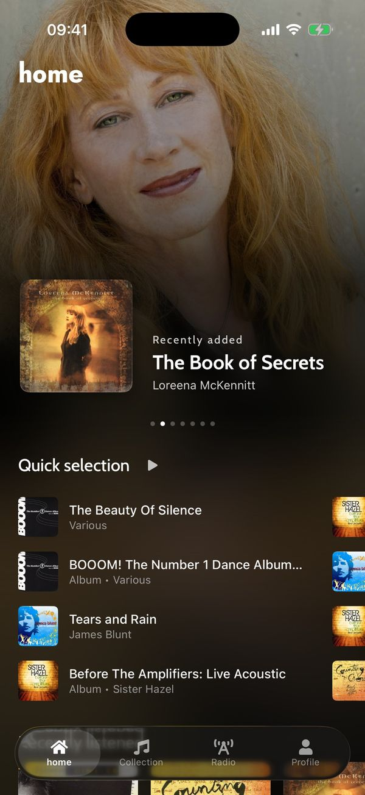
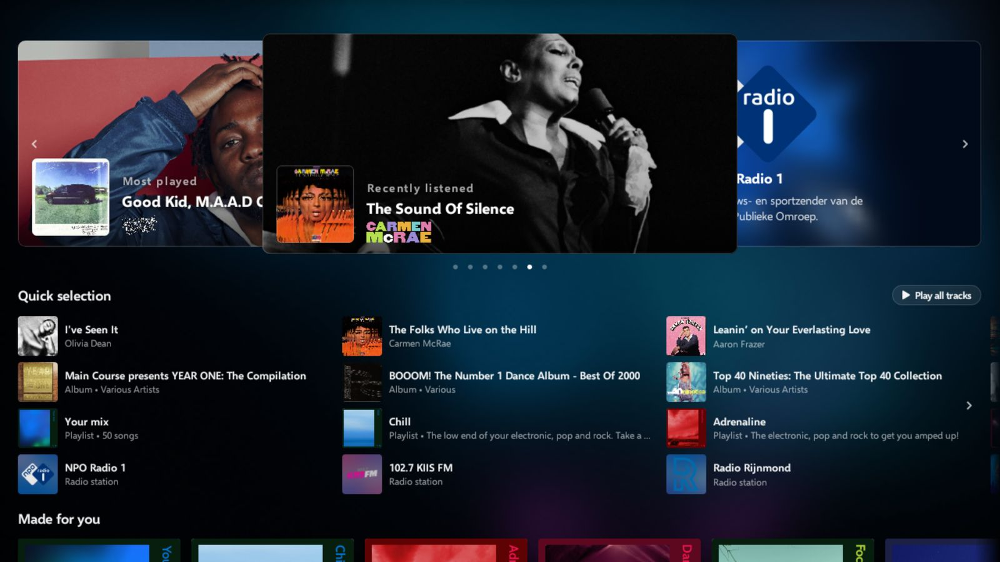

# rpm

rpm is a music player for your own music. It plays the files you have, on your computer, phone and
TV, and can keep your library in the cloud so it is the same everywhere.

The apps are open source under the [Mozilla Public License 2.0](LICENSE). Website:
[rpmrpmrpm.com](https://rpmrpmrpm.com).

  

  
  

rpm on a Mac, on an iPhone and on Android TV. The record covers and photographs in the screenshots
belong to their owners; the code licence does not cover them.

## The repos

| Repo | App | Language |
| --- | --- | --- |
| [`rpm-desktop`](https://github.com/rpmrpmrpm/rpm-desktop) | Windows, macOS and Linux | C#, .NET, Uno Platform |
| [`rpm-apple`](https://github.com/rpmrpmrpm/rpm-apple) | iPhone and Apple TV | Swift, SwiftUI |
| [`rpm-android`](https://github.com/rpmrpmrpm/rpm-android) | Android phone and Android TV | Kotlin, Jetpack Compose |
| `rpm` (this repo) | Shared between the apps | |

This repo holds what the apps share:

- **Discussions**: ideas, questions and plans for all apps.
- **`strings.json`**: every piece of text the apps show, in English, French, Spanish, German and
  Simplified Chinese, with the script that generates each app's string files.
- **The generators** that write those strings and the other shared tables into each app.
- **`cast/`**: the web page a Chromecast shows when an app casts to it.

The requests the apps send to the rpm server, and the answers they get, are kept as example JSON in
`rpm-apple` (`RPM.iOS/Modules/RPMKit/Tests/RPMKitTests/Fixtures`). The server itself is not open
source.

## Contributing

Read [CONTRIBUTING.md](CONTRIBUTING.md). In short: ideas go to Discussions, bugs to the issues of
the app's repo, and code to a pull request on the app's repo. Sign off your commits.

Please follow the [code of conduct](CODE_OF_CONDUCT.md). Report security problems privately, as
described in [SECURITY.md](SECURITY.md).

## Name and logo

The code licence does not cover the name "rpm", the logo or the app icons. See
[TRADEMARKS.md](TRADEMARKS.md).
